<div align="center">
<h1><a id="intro"> cdxgen-distroless <sup></sup></a><br></h1>
<a href="https://docs.github.com/en"></a>
<a href="https://daringfireball.net/projects/markdown"></a>
<a href="https://symbl.cc/en/unicode-table"></a>
<a href="https://shields.io"></a>

</div>

<div align="center">


</div>

<div align="center">

[](https://github.com/geminishkv/cdxgen-distroless/actions/workflows/ci.yml)
[](https://hub.docker.com/r/geminishkvdev/cdxgen-distroless)
[](LICENSE)
[](https://github.com/geminishkv/cdxgen-distroless/pkgs/container/cdxgen-distroless)

</div>

Образ генератора SBOM [cdxgen](https://github.com/CycloneDX/cdxgen) на distroless: SBOM проекта без сети и без установки зависимостей, без оболочки внутри и от непривилегированного пользователя.

**Что делает:**

- строит SBOM в формате CycloneDX по манифестам и lock-файлам проекта: каталог монтируется только на чтение, сеть контейнеру не нужна;
- для Python-проекта без lock-файла сначала разрешает зависимости через `uv pip compile` — без установки и сборки пакетов;
- не содержит оболочки, `apt`, `npm` и `pip`: в образе только Node.js, cdxgen, `uv` и стандартная библиотека Python;
- публикуется в Docker Hub и GHCR для `linux/amd64` и `linux/arm64` с provenance, SBOM и подписью cosign keyless;
- перед каждой публикацией проходит пайплайн безопасности: gitleaks, hadolint, Trivy по Dockerfile и по сборке образа, SBOM.

***

## Состав образа

| Компонент | Версия | Источник |
| --- | --- | --- |
| [cdxgen](https://github.com/CycloneDX/cdxgen) | 12.9.0 | npm-пакет `@cyclonedx/cdxgen`, зависимости по `package-lock.json` |
| Node.js | 24 | база `gcr.io/distroless/nodejs24-debian13:nonroot` |
| [uv](https://github.com/astral-sh/uv) | 0.13.6 | `ghcr.io/astral-sh/uv` |
| Python, только stdlib | 3.12 | `python:3.12-slim` без `pip`, `ensurepip`, `idlelib`, `tkinter` и тестов |

- Пользователь `65532:65532`, рабочий каталог `/app`, `HOME=/tmp`.
- `ENTRYPOINT` — cdxgen: аргументы после имени образа уходят ему напрямую.
- Базовые образы закреплены по digest в `ARG` в [Dockerfile](Dockerfile).
- Поверх пакета базы лежит `zlib1g` 1.3.2-4 из Debian sid: в trixie исправления CVE-2026-76844 и CVE-2026-85091 ещё нет. Наложение временное, это стадия `zlib` в `Dockerfile`. Trivy показывает обе CVE и закрытую той же версией CVE-2026-27171 и на исправленном пакете, пока исправлений нет в trixie: это ложные срабатывания, исключения с причиной — в [.trivyignore.yaml](.trivyignore.yaml).
- Версия образа равна версии cdxgen внутри, тег `latest` переставляет каждый прогон `release`.
- `LICENSE` и `NOTICE` репозитория лежат в образе в `/licenses`.

***

## Получение образа

```bash
docker pull geminishkvdev/cdxgen-distroless:12.9.0
docker pull ghcr.io/geminishkv/cdxgen-distroless:12.9.0
```

Тег повторяет версию cdxgen и может быть пересобран при обновлении базовых образов, поэтому в пайплайнах стоит закреплять digest. Он печатается в сводке прогона `release`, в заметках GitHub Release и в описании на Docker Hub:

```bash
docker pull ghcr.io/geminishkv/cdxgen-distroless@sha256:<digest>
```

***

## Запуск

Установка зависимостей ради SBOM исполняет на агенте CI чужой код: сборочные и install-скрипты пакетов. Образ рассчитан на режим, где этого не происходит: cdxgen только читает файлы проекта.

### Проект с lock-файлом

```bash
IMAGE=geminishkvdev/cdxgen-distroless:12.9.0

docker create --name cdxgen-sbom --network none \
  -v "$PWD":/app:ro "$IMAGE" \
  -t js --spec-version 1.6 --no-install-deps -o /tmp/bom.json /app
docker start -a cdxgen-sbom
docker cp cdxgen-sbom:/tmp/bom.json bom.json
docker rm cdxgen-sbom
```

| Параметр | Зачем |
| --- | --- |
| `--network none` | сеть контейнеру не нужна |
| `-v "$PWD":/app:ro` | проект монтируется только на чтение |
| `-t js` | тип проекта, [список типов](https://cdxgen.github.io/cdxgen/#/PROJECT_TYPES) — в документации cdxgen |
| `--spec-version 1.6` | версия CycloneDX; по умолчанию у cdxgen 1.7, пайплайн репозитория использует 1.6 |
| `--no-install-deps` | cdxgen не пытается ставить зависимости и читает lock-файлы как есть |
| `-o /tmp/bom.json` | результат пишется внутри контейнера и забирается через `docker cp` |

Результат копируется из остановленного контейнера, поэтому вместо `docker run --rm` используются `docker create` и `docker start -a`. Capabilities контейнеру не нужны: команда работает и с `--cap-drop ALL --security-opt no-new-privileges`.

### Python-проект без lock-файла

Без lock-файла и без сети cdxgen вернёт пустой SBOM. Сначала зависимости разрешает `uv`, затем cdxgen строит SBOM по закреплённому списку уже без сети:

```bash
mkdir -p sbom-work && cp pyproject.toml sbom-work/

docker create --name cdxgen-uv --entrypoint /usr/local/bin/uv \
  -v "$PWD":/app:ro "$IMAGE" \
  pip compile --no-build --no-config --no-sources --no-python-downloads \
  /app/pyproject.toml -o /tmp/requirements.txt
docker start -a cdxgen-uv
docker cp cdxgen-uv:/tmp/requirements.txt sbom-work/requirements.txt
docker rm cdxgen-uv

docker create --name cdxgen-sbom --network none \
  -v "$PWD/sbom-work":/app:ro "$IMAGE" \
  -t python --spec-version 1.6 --no-install-deps -o /tmp/bom.json /app
docker start -a cdxgen-sbom
docker cp cdxgen-sbom:/tmp/bom.json bom.json
docker rm cdxgen-sbom
```

| Параметр `uv` | Зачем |
| --- | --- |
| `--no-build` | пакеты не собираются из исходников; пакет без wheel останавливает резолв с именем пакета |
| `--no-config` | настройки uv из проекта (`uv.toml`, `[tool.uv]`) не читаются: проект не подменит индекс по умолчанию |
| `--no-sources` | `[tool.uv.sources]` не применяется: проект не уведёт отдельный пакет на свой индекс |
| `--no-python-downloads` | используется только интерпретатор образа |

Шагу резолва нужна сеть до индекса пакетов: по умолчанию это PyPI, другой индекс задаётся флагом `--default-index`.

### Ограничения

В образе нет сборочных тулчейнов: JDK, Maven, Gradle, Go, .NET SDK. cdxgen видит только то, что записано в манифестах и lock-файлах проекта.

***

## Выходные артефакты

| Артефакт | Где лежит | Что это |
| --- | --- | --- |
| `bom.json` | каталог запуска | SBOM проекта, CycloneDX JSON |
| образ с тегами версии и `latest` | Docker Hub, GHCR | индекс для `linux/amd64` и `linux/arm64` |
| provenance и SBOM образа | реестр, рядом с образом | аттестации BuildKit: provenance `mode=max` и SBOM в формате SPDX от закреплённого генератора |
| подпись cosign | реестр, рядом с образом | keyless, сертификат выписан на workflow `release.yml` |
| аттестация происхождения GitHub | GHCR | `actions/attest-build-provenance` |
| GitHub Release | страница релизов репозитория | заметки: изменения из `CHANGELOG.md`, адреса образа по digest, состав, команды запуска и проверки; во вложениях SBOM опубликованных образов по платформам (SPDX) и три схемы |
| описание на Docker Hub | страница репозитория в Docker Hub | обзор образа: теги и digest текущего выпуска, запуск, состав, проверка подписи, схемы |
| `security-*` | артефакты прогона Actions | отчёты слоёв, `sbom-image.cdx.json` от syft и `sbom-cdxgen.cdx.json` от cdxgen |

***

## Проверка подписи и происхождения

```bash
DIGEST=sha256:<digest>

cosign verify "ghcr.io/geminishkv/cdxgen-distroless@$DIGEST" \
  --certificate-identity-regexp '^https://github.com/geminishkv/cdxgen-distroless/\.github/workflows/release\.yml@refs/' \
  --certificate-oidc-issuer https://token.actions.githubusercontent.com

gh attestation verify "oci://ghcr.io/geminishkv/cdxgen-distroless@$DIGEST" --owner geminishkv
```

Подпись сделана cosign 3 в формате bundle, для проверки нужен cosign 3.x; `gh attestation verify` требует выполненного `gh auth login`. Образ в Docker Hub подписан так же: в `cosign verify` меняется только адрес образа. Те же команды с подставленным digest есть в сводке прогона `release` и в заметках GitHub Release.

***

## Сборка и локальные проверки

```bash
docker build -t cdxgen-distroless:dev .

python3 scripts/security/install.py trivy hadolint syft gitleaks
python3 scripts/security/hadolint.py Dockerfile
python3 scripts/security/trivy_config.py Dockerfile
python3 scripts/security/trivy_image.py cdxgen-distroless:dev
python3 scripts/security/sbom.py cdxgen-distroless:dev
python3 scripts/security/gitleaks.py

python3 -m unittest discover -s tests
pre-commit run --all-files
```

`install.py` скачивает сканеры в `.local/security/bin` по версии и sha256 из `scripts/security/common.py`; пины заведены для Linux x86_64 и macOS arm64, у hadolint — ещё и для Linux arm64. Отчёты складываются в `.local/security/reports`. Скрипты те же, что вызывает CI. `pre-commit run --all-files` проверяет файлы, которые уже под git. Гейт проверен на macOS arm64 и Linux x86_64; на Linux arm64 `pre-commit` не поднимется: у `taplo` нет готового wheel под эту платформу.

***

## CI/CD

| Workflow | Триггер | Назначение |
| --- | --- | --- |
| [`ci.yml`](.github/workflows/ci.yml) | pull request в `main`, push в `main`, вручную | `lint`: `pre-commit run --all-files` и `unittest`; `security`: вызов `security.yml` |
| [`security.yml`](.github/workflows/security.yml) | `workflow_call`, вручную | сборка образа для `linux/amd64`, сканеры, вердикт `gate`, сводка `report` |
| [`release.yml`](.github/workflows/release.yml) | тег `v*`, вручную | `security`, затем `publish`: сборка под две архитектуры, публикация, подпись, аттестация, выгрузка SBOM образа; на теге — `release-notes`: GitHub Release с вложениями и `dockerhub-description`: описание на Docker Hub |

### Пайплайн безопасности

| Job | Инструмент | Что проверяет | Гейт |
| --- | --- | --- | --- |
| `gitleaks` | gitleaks | секреты во всей истории git | любая находка |
| `hadolint` | hadolint | Dockerfile | `error` и `warning` |
| `trivy-config` | Trivy | misconfiguration в Dockerfile | `HIGH` и `CRITICAL` |
| `trivy-image` | Trivy | уязвимости пакетов ОС, npm и зависимостей бинаря `uv` в образе | `CRITICAL` и `HIGH` с доступным исправлением |
| `sbom` | syft и cdxgen из образа | состав образа, CycloneDX 1.6 | находок не даёт |

- Один сканер — один job. Логика лежит в `scripts/security/*.py`, workflow только вызывают скрипты.
- Каждый скрипт проверяет покрытие: ноль просмотренных объектов считается отказом инструмента, а не успехом.
- `gate` красный, если хотя бы один из четырёх гейтящих слоёв не `success`, в том числе отменён или пропущен.
- `report` — единственный job с правом записи (`pull-requests: write`): сводка в `GITHUB_STEP_SUMMARY` и один обновляемый комментарий в pull request с рейтингом и дельтой к прошлому прогону. Когда токен только на чтение (pull request из форка), комментарий не пишется, сводка остаётся в прогоне.
- Рейтинг считается по новым находкам: E — есть critical; D — high больше 5; C — high от 1 до 5 или medium больше 10; B — есть medium; A — ничего из этого.
- Исключения действуют только из файлов: принятые находки Trivy — `.trivyignore.yaml` с причиной и сроком, исключения gitleaks — `.gitleaks.toml` по коммиту и пути. Комментарии `gitleaks:allow` и прагмы `hadolint ignore` не действуют, а `.hadolint.yaml` в каталоге и `trivy:ignore` в Dockerfile останавливают слой.
- Правила `trivy config` — встроенные в закреплённую версию Trivy, набор при прогоне не обновляется.
- Сканируется сборка `linux/amd64` из того же Dockerfile и тех же закреплённых входов; публикуемые образы обеих архитектур `publish` собирает заново.
- `publish` запускается только после успешного `security.yml` целиком, включая `sbom` и `report`.

### Секреты

| Куда | Чем авторизуется job | Что завести в репозитории |
| --- | --- | --- |
| Docker Hub, образ | `DOCKERHUB_USERNAME`, `DOCKERHUB_TOKEN` | два секрета; токен Docker Hub с правами Read & Write, если репозиторий на Docker Hub уже создан, иначе Read, Write, Delete: создать репозиторий при первой публикации может только он |
| Docker Hub, описание | `DOCKERHUB_USERNAME`, `DOCKERHUB_DESCRIPTION_TOKEN` | ещё один секрет: отдельный токен с правами Read, Write, Delete |
| GHCR | `github.token`, право `packages: write` | ничего |
| Подпись cosign и аттестация | OIDC, права `id-token: write` и `attestations: write` | ничего |
| GitHub Release | `github.token`, право `contents: write` | ничего |

Менять описание Docker Hub разрешает только токену с правом Delete, поэтому токен отдельный: в job `publish`, где работают сторонние actions, он не попадает. В форке достаточно завести три секрета Docker Hub и заменить адреса: образов — в `env` в `release.yml`, репозитория — в метке `org.opencontainers.image.source` в `Dockerfile` и в `SECURITY.md`, владельца — в `.github/CODEOWNERS`. Пространство имён Docker Hub не обязано совпадать с владельцем на GitHub: здесь это `geminishkvdev` и `geminishkv`.

### Релиз

```bash
git tag -a v12.9.0 -m "cdxgen-distroless 12.9.0"
git push origin v12.9.0
```

Тег обязан совпадать с версией `@cyclonedx/cdxgen` в `package.json`, а в `CHANGELOG.md` должен быть раздел `[версия]` — из него собираются заметки релиза. При расхождении `scripts/release_version.py` останавливает `publish` до сборки; там же проходит сухой рендер заметок и описания Docker Hub, чтобы ошибка шаблона не всплыла после публикации образа. Ручной запуск `release` разрешён только с основной ветки или с тега версии.

На теге job `release-notes` создаёт GitHub Release. Текст собирается по шаблону [`scripts/templates/release_notes.md`](scripts/templates/release_notes.md): раздел `CHANGELOG.md`, адреса образа по digest, состав из `Dockerfile`, команды запуска и проверки. Во вложениях — три схемы и SBOM опубликованных образов, которые `scripts/release_sbom.py` выгружает из аттестаций реестра. Release создаётся черновиком и публикуется после загрузки вложений. Затем job `dockerhub-description` обновляет описание репозитория на Docker Hub по шаблону [`scripts/templates/dockerhub.md`](scripts/templates/dockerhub.md). Ручной запуск с ветки публикует только образ.

Предпросмотр обоих текстов до релиза, с нулевым digest:

```bash
python3 scripts/release_notes.py render
python3 scripts/dockerhub_description.py render
```

### Обновления

Actions закреплены по SHA; образы BuildKit, binfmt и генератора SBOM в workflow — по digest. Dependabot обновляет npm раз в неделю, GitHub Actions и хуки pre-commit раз в месяц, везде с cooldown 7 дней. Вручную обновляются базовые образы в `ARG` в `Dockerfile` (Dependabot разбирает только литеральные строки `FROM`, поэтому запись `docker` в `dependabot.yml` сейчас ничего не обновляет), три образа в workflow и версии сканеров в `scripts/security/common.py`. Стадию `zlib` в `Dockerfile` и три записи о `zlib1g` в `.trivyignore.yaml` нужно убрать, когда исправление появится в базе distroless; срок записей — 2026-12-05.

Локальный гейт — [`.pre-commit-config.yaml`](.pre-commit-config.yaml). Job `lint` выполняет те же хуки, кроме gitleaks: историю проверяет отдельный job; zizmor в CI работает с токеном и включает онлайн-аудиты.

***

## Архитектура

Три схемы по ГОСТ 19.701-90. Исходники — [`docs/diagrams/*.mmd`](docs/diagrams/), рядом лежат SVG, отрендеренные `mmdc` (mermaid-cli 12.2.0). После правки исходника SVG перерендерить:

```bash
mmdc -c docs/diagrams/mermaid.config.json -i docs/diagrams/image.mmd -o docs/diagrams/image.svg
mmdc -c docs/diagrams/mermaid.config.json -i docs/diagrams/security.mmd -o docs/diagrams/security.svg
mmdc -c docs/diagrams/mermaid.config.json -i docs/diagrams/delivery.mmd -o docs/diagrams/delivery.svg
```

Вид задаёт `mermaid.config.json`: классический стиль, шрифт Arial, размер по содержимому и фиксированный seed, поэтому повторный рендер на той же версии даёт тот же файл.

### Сборка образа



### Пайплайн безопасности



### CI и релиз


***

## Структура репозитория

```text
cdxgen-distroless/
├── Dockerfile                  # multi-stage: build, uv, python, zlib, итог на distroless
├── .dockerignore               # allowlist: package*.json, LICENSE, NOTICE
├── package.json                # версия cdxgen и overrides
├── package-lock.json           # закреплённое дерево зависимостей cdxgen
├── scripts/
│   ├── security/
│   │   ├── common.py           # пины сканеров, покрытие, сводка слоя
│   │   ├── install.py          # установка сканеров по версии и sha256
│   │   ├── gitleaks.py         # секреты в истории
│   │   ├── hadolint.py         # линтер Dockerfile
│   │   ├── trivy_config.py     # misconfiguration
│   │   ├── trivy_image.py      # уязвимости образа, гейт
│   │   ├── sbom.py             # SBOM образа: syft и cdxgen
│   │   └── report.py           # вердикт гейта, сводка, комментарий в PR
│   ├── templates/              # шаблоны: release_notes.md, dockerhub.md
│   ├── release_version.py      # версия образа, сверка тега, CHANGELOG и ветки
│   ├── release_summary.py      # сводка релиза: digest и команды проверки
│   ├── release_sbom.py         # SBOM опубликованного образа из аттестаций реестра
│   ├── release_notes.py        # заметки, вложения и GitHub Release тега
│   ├── dockerhub_description.py # описание репозитория на Docker Hub
│   └── check_links.py          # относительные ссылки в *.md
├── tests/                      # unittest: сводка, сканеры, релизные скрипты, пины
├── docs/diagrams/              # схемы: *.mmd, *.svg, mermaid.config.json
├── .github/
│   ├── workflows/              # ci.yml, security.yml, release.yml
│   ├── dependabot.yml
│   └── CODEOWNERS
├── .pre-commit-config.yaml     # локальный гейт
├── .gitleaks.toml              # allowlist gitleaks
├── .trivyignore.yaml           # baseline Trivy
├── .markdownlint.json
├── .gitignore
├── ruff.toml
├── assets/logo.jpg
├── CHANGELOG.md
├── SECURITY.md
├── NOTICE
└── LICENSE
```

***

Лицензия — [Apache-2.0](LICENSE), сторонние компоненты перечислены в [NOTICE](NOTICE). Как сообщить об уязвимости — в [SECURITY.md](SECURITY.md).

Copyright (c) 2026 Elijah S Shmakov


